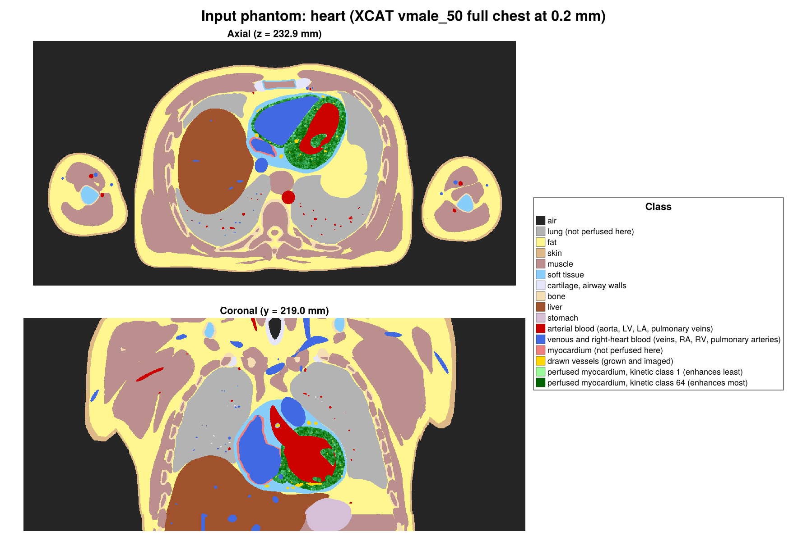
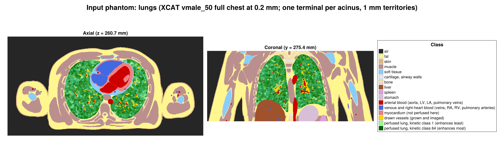

# Vasculature.jl

[](https://github.com/MolloiLab/Vasculature.jl/actions/workflows/CI.yml)
[](LICENSE)

| Heart: contrast through the grown coronary tree | Lung: contrast through the grown pulmonary trees |
|:---:|:---:|
|  |  |

Grow a complete vascular tree inside any organ from the few vessels a scan shows, compute its blood flow from the
pressures alone, send a contrast injection through it, and export a voxelized perfusion phantom for CT simulation.
One algorithm for every organ; an organ differs only in the numbers you give it.

## Install

```julia
using Pkg
Pkg.add(url = "https://github.com/MolloiLab/Vasculature.jl")
```

## 1. Grow


You give four things; everything else is the same for every organ:

1. **The organ**: a closed surface mesh of the tissue to perfuse (`mesh_domain` turns it into a 1 mm voxel domain), or a
   ready voxel mask (`.vol`). Terminals are placed only inside it.
2. **The inlets**: the vessels the scan shows, one tree per inlet, as GXL centrelines with radii. Growth starts from
   them and never moves them.
3. **The regions to avoid** (optional): anything inside or next to the organ that a vessel must not cross, such as the
   heart's chambers and great vessels, the lung's airways or the brain's ventricles. Give them as a fine voxel mask
   (`true` = forbidden) with its origin and cell size; every new vessel segment is checked against it.
4. **A `GrowthSpec`**: how many terminals, the tissue volume, the imaged inlet radii.

```julia
using Vasculature

domain = mesh_domain("heart.vol", vertices, triangles) # organ surface → 1 mm domain
# an organ is an instance of the one GrowthSpec struct (HEART_GROWTH, LUNG_GROWTH, ...); a run varies it
spec = GrowthSpec(HEART_GROWTH; device = MtlArray)
avoid = (chambers, origin_mm, 0.4) # forbidden mask, centre of its first cell (mm), cell size (mm)
tree = grow(spec, domain, ["lca.xml", "rca.xml"]; blockers = avoid)
```

On a laptop GPU (Apple M4) the heart grows 10⁶ terminals in about 40 seconds.

How many terminals grow is the organ's own number. For an organ that feeds its tissue, `flow_ml_min` sets it: the
flow is the tissue's O₂ demand by Fick, over the flow of one terminal of the heart tree scored against Kassab's
morphometry (0.14 µL/min, about 12 µm across). The lungs carry the whole cardiac output but are not fed by it, so their
count comes from their structure instead: one terminal per acinus (`nterm`), with the vessels inside each acinus
solved below it in `flow`. You can always give `nterm` directly.

| | `flow_ml_min` | → terminals | `tissue_ml` | inlets |
|---|---|---|---|---|
| heart (adult, rest) | 135.6 | 957,045 | 148 (myocardium) | LCA, RCA |
| lungs (adult) | (4,800 cardiac output, not used for the count) | 29,912 acini (Vasilescu et al. 2020) | 2,813 | main pulmonary artery |
| brain (older adult, rest) | 510 (van Es et al. 2010) | 3.6 million | 1,016 (parenchyma) | both internal carotids, both vertebrals |
| one leg (adult, rest) | 290 for the whole leg (Koch Esteves et al. 2023: 2.6 mL/min per 100 mL) | 2.0 million | 11,000 (whole leg: skin, fat, bone, muscle) | common femoral artery |
| any organ | VO₂ ÷ (arterial O₂ content × O₂ extraction) | flow ÷ 0.14 µL/min | its segmented volume | each imaged inlet (femoral artery, carotids + basilar, ...) |

`tissue_ml` is the volume of the domain you grow into, and the flow must be that domain's: for a leg, 2.6 mL/min per
100 mL of tissue at rest (at that whole-leg mean, a 7 L domain gets about 180 mL/min, not the whole leg's 290; muscle at rest may take a larger
share). Count a `.vol`
domain's volume with `img, _ = read_vol("leg.vol"); count(>(0x80), img) / 1000` (mL, 1 mm voxels).

XCAT inputs (NURBS surfaces, vessel centrelines, organ masks) are read with `Vasculature.XCAT` (`read_nrb`, `centerline`,
`base_forest`, `penetrating_stubs`, `fill_supply_gaps`).

Imaged arteries rarely show their small side branches, and growth attaches new vessels near the inlet tree's ends after its
first stage. `penetrating_stubs` adds a short branch into the tissue about every `spacing` mm along each imaged vessel,
where tissue is within reach and no imaged branch is already there, so growth starts along the whole vessel. The heart
input uses it (2.8 mm, the pig LAD's segment length); another organ passes `scale = size_scale(spec)`, and a bare trunk
such as a femoral artery needs it most.

More inlets are just more files: `grow(spec, brain, ["lica.xml", "rica.xml", "basilar.xml"])`.
Veins grow the same way from their imaged outlet trees (`grow(spec, domain, ["left_pulmonary_veins.xml", "right_pulmonary_veins.xml"])`).

## 2. Flow


```julia
arteries, veins = vtree(tree), vtree(veintree) # grown trees as vessel lists
F = flow(HEART_FLOW, arteries, veins, tissue) # tissue: 3 × n voxel centres (mm)
F.rest.resist.mbf, F.stress.resist.mbf # mL/min/g at rest and at maximal dilation
```

No flow is prescribed: each vessel's flow follows from the inlet and outlet pressures, the vessel sizes and the
arterioles' tone. `HEART_FLOW` and `LUNG_FLOW` are instances of the one `FlowSpec` struct, every value
measured and cited; a variant is `FlowSpec(HEART_FLOW; p_in = 70)`.

## 3. Contrast


A clinical injection (dose, rate, saline flush, injection site) travels through a whole-body circulation into the
organ's grown tree, then through every capillary bed and vein, with exchange into the tissue and washout by the kidneys.

```julia
T = transport(HEART_TRANSPORT, F.rest; times = HEART_PHANTOM.times) # default injection; LUNG_TRANSPORT for the lungs
T.tissue, T.artery, T.vein # iodine (mg) in every terminal bed and vessel, every second
```

`HEART_TRANSPORT` and `LUNG_TRANSPORT` are instances of the one `TransportSpec` struct: which body segment the organ
replaces, where its blood comes from, its tissue volume. The organ's venous outflow is fed back into the body until it
stops changing, so recirculation is included.

## 4. Phantom



The result is one folder per scenario (healthy, a stenosis, ...), every file on one grid:

| file | what it holds |
|---|---|
| `labels.u16.zst` | every voxel's label |
| `rois.u8.zst` | every voxel's ROI: the compartments ground truth is given for |
| `mbf_rest.f32.zst`, `mbf_stress.f32.zst` | every voxel's ground-truth blood flow (mL/min/g; vessels 0) |
| `label_rest.csv`, `label_stress.csv` | one row per label: ROI, kind, base material, mass, ground-truth MBF, iodine (mg/mL) every second |
| `ledger_rest.csv`, `ledger_stress.csv` | the organ's iodine every second: delivered, held in arteries, beds and veins, out through the veins, painted |
| `phantom.toml` | the grid, the ROI names and groups, the tracking points, the scenario's facts |

Load it at any time point as material maps for a CT simulator such as
[BasisSimulator.jl](https://github.com/MolloiLab/BasisSimulator.jl).

```julia
scans = [("rest", F.rest, Trest), ("stress", F.stress, Tstress)]
R = phantom(HEART_PHANTOM, scans, classify, Vasculature.VoxelGrid(origin, 0.2, dims); F.pairs, F.terr, nvox,
    out = "heart_healthy", roi, roi_names, roi_groups = ["LV" => [1, 2, 3], "RV" => [4, 5, 6]],
    tracking = ["descending aorta" => (x, y, z)])

ph = Vasculature.DynamicPhantom.load("heart_healthy"; rois = true) # the bundle
P, m = Vasculature.DynamicPhantom.bs_phantom(ph, BasisSimulator; state = "rest", t = 25) # material map at t = 25 s
```

An ROI is a compartment: a region of the organ with everything in it, tissue and
every artery, vein and lumen that lies in it (`roi(p)` says which ROI the voxel at `p` is in). Every label lies in one
ROI, so an ROI is a set of whole labels: `ph.roi_table[(state, name)]` sums them into its iodine mass curve and its ground
truth, the flow its capillary beds receive over the mass of everything in it. A label's iodine is its members' mass over
their painted volume, so the phantom holds exactly the iodine the transport put in the organ, and the ledger
(`ph.ledger[state]`) checks it at every second: the build fails if delivered ≠ held + outflow or painted ≠ held.
`DynamicPhantom.scan_times` picks scan times from a tracking point's curve (`ph.reference`). A large phantom can be
loaded a slab at a time: `DynamicPhantom.load(dir; zrange = 400:700)`.

`classify(p)` and `roi(p)` are the subject-specific steps: for a voxel centre they say what is there (a static material,
a blood pool of the body model, perfused tissue, or a grown vessel) and which compartment it belongs to. Everything
else, the tissue's kinetic classes, the grown vessels drawn into the tissue, the pools' curves and the ledger, is the
same for every organ. `HEART_PHANTOM` and `LUNG_PHANTOM`
are instances of the one `PhantomSpec` struct.

A new organ (brain, kidney, leg) is four more instances, `GrowthSpec`, `FlowSpec`, `TransportSpec` and `PhantomSpec`,
plus its classifier; no new code path.

The pictures are the lab's two input phantoms of XCAT vmale_50, the whole chest at 0.2 mm, with the heart (above) and
the lungs (below) as the perfused organ. Like every ground truth in the lab they are drawn as categorical maps, one flat
colour per class. The perfused tissue's kinetic classes are shades of green, from the least to the most enhancing, and
the vessels drawn into the tissue are gold. Grayscale is kept for images that have been through a scanner (a
simulation in BasisSimulator.jl, or a real CT).



## How to cite

The growth algorithm is HCT-CCO, extended from OpenCCO. If you use tree growth, please cite:

- S. L. Vajire, J. S. Choy, G. S. Kassab, L.-C. Lee. Hierarchy aware CT-driven constrained constructive optimization:
  a framework for coronary network generation. *Ann. Biomed. Eng.*, 2026. doi:10.1007/s10439-026-04383-4
- B. Kerautret, P. Ngo, N. Passat, H. Talbot, C. Jaquet. OpenCCO: an implementation of constrained constructive
  optimization for generating 2D and 3D vascular trees. *Image Process. On Line* 13:258–279, 2023.
  doi:10.5201/ipol.2023.477

## License

GPL-3.0-or-later. The growth engine is a port of HCT-CCO; its provenance, attribution and upstream licenses are
in [docs/NOTICE.md](docs/NOTICE.md).
