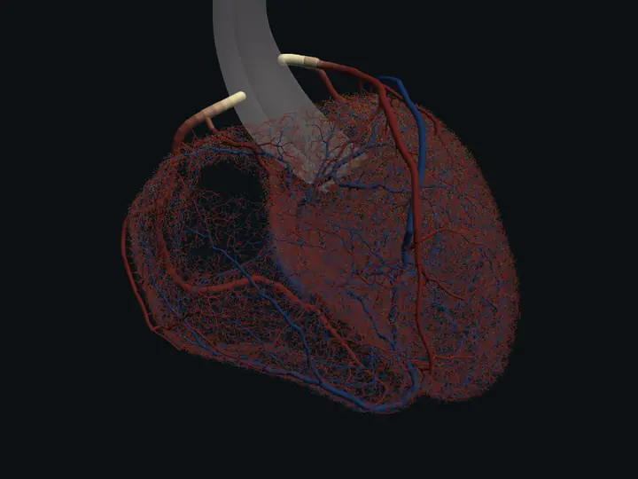
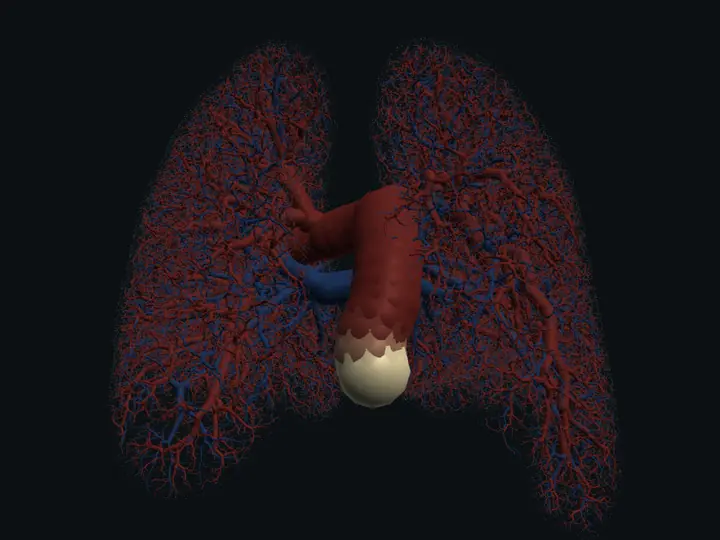
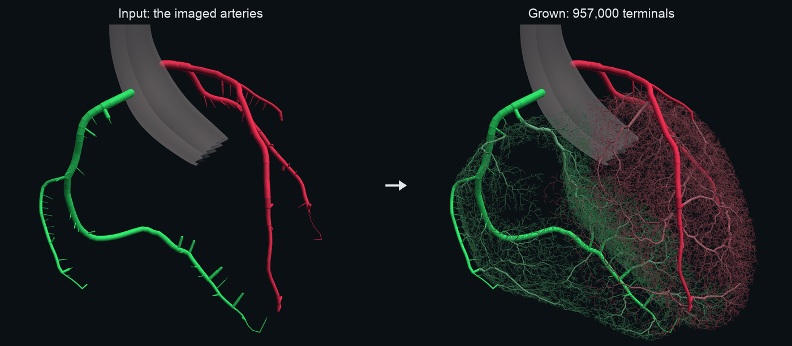
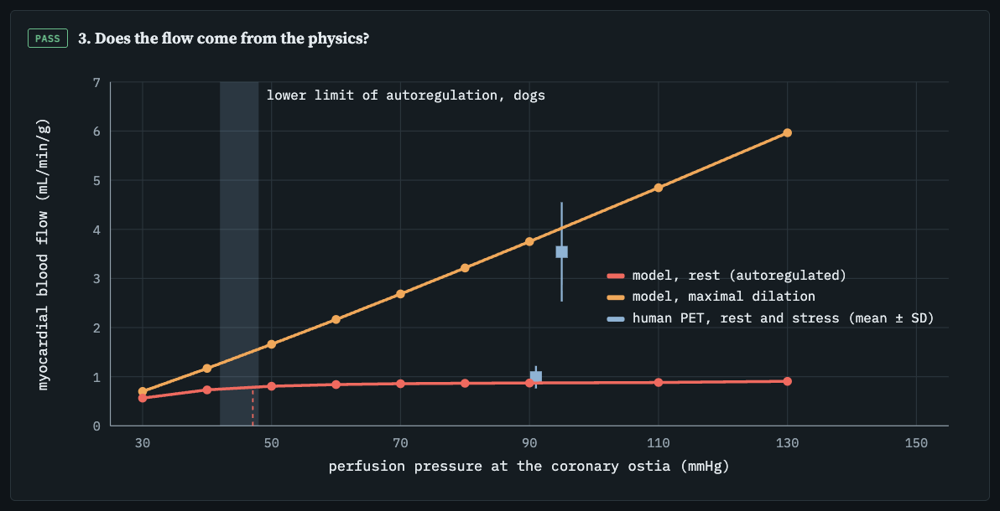
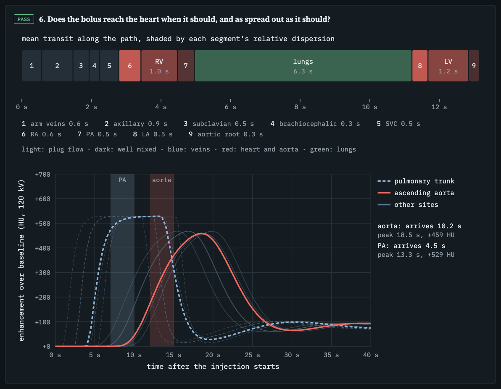
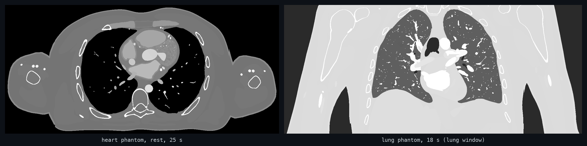
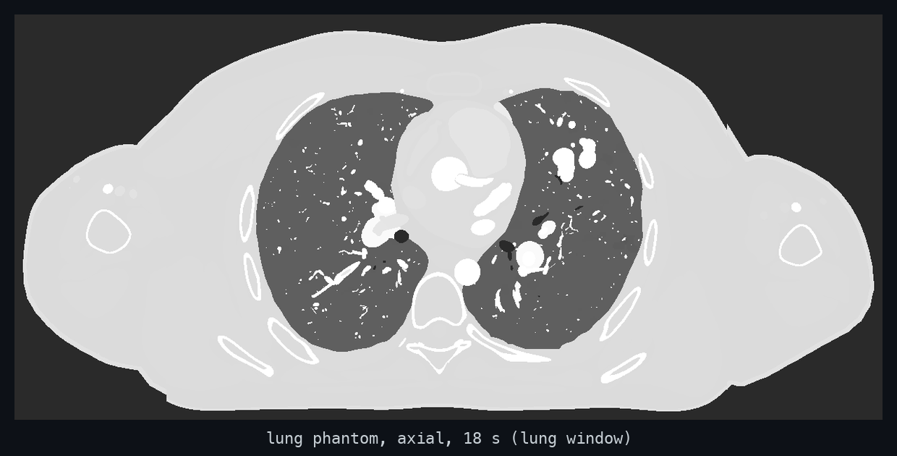

# Vasculature.jl

[](https://github.com/MolloiLab/Vasculature.jl/actions/workflows/CI.yml)
[](LICENSE)

| Heart: contrast through the grown coronary tree | Lung: contrast through the grown pulmonary trees |
|:---:|:---:|
|  |  |

Grow a complete vascular tree inside any organ from the few vessels a scan shows, compute its blood flow from the
pressures alone, send a contrast injection through it, and export a voxelized perfusion phantom for CT simulation.
One algorithm for every organ; an organ differs only in the numbers you give it.

## Install

```julia
using Pkg
Pkg.add(url = "https://github.com/MolloiLab/Vasculature.jl")
```

## 1. Grow



You give four things; everything else is the same for every organ:

1. **The organ**: a closed surface mesh of the tissue to perfuse (`mesh_domain` turns it into a 1 mm voxel domain), or a
   ready voxel mask (`.vol`). Terminals are placed only inside it.
2. **The inlets**: the vessels the scan shows, one tree per inlet, as GXL centrelines with radii. Growth starts from
   them and never moves them.
3. **The regions to avoid** (optional): anything inside or next to the organ that a vessel must not cross, such as the
   heart's chambers and great vessels, the lung's airways or the brain's ventricles. Give them as a fine voxel mask
   (`true` = forbidden) with its origin and cell size; every new vessel segment is checked against it.
4. **A `GrowthSpec`**: how many terminals, the tissue volume, the imaged inlet radii.

```julia
using Vasculature

domain = mesh_domain("heart.vol", vertices, triangles) # organ surface → 1 mm domain
spec = GrowthSpec(
    nterm = 1_000_000, # terminals
    tissue_ml = 148.1, # tissue volume (mL)
    root_caps = [2.54, 1.59], # imaged inlet radii (mm): LCA, RCA
)
avoid = (chambers, origin_mm, 0.4) # forbidden mask, its corner (mm), cell size (mm)
tree = grow(spec, domain, ["lca.xml", "rca.xml"]; blockers = avoid)
```

On a laptop GPU (Apple M4) the heart grows 10⁶ terminals in about a minute.

| | `nterm` | `tissue_ml` | inlets | `root_caps` |
|---|---|---|---|---|
| heart (adult) | 1,000,000 | 148 (myocardium) | LCA, RCA | imaged ostial radii |
| lung (adult, both) | 200,000 | 2,800 | main pulmonary artery | imaged main-PA radius |
| any other organ | your choice (more = finer) | its segmented volume | each imaged inlet (femoral artery, carotids + basilar, ...) | their imaged radii |

More inlets are just more files: `grow(spec, brain, ["lica.xml", "rica.xml", "basilar.xml"])`.
Veins grow the same way from their imaged outlet trees (`grow(spec, domain, ["left_pulmonary_veins.xml", "right_pulmonary_veins.xml"])`).

## 2. Flow



```julia
F = flow(FlowSpec(organ = "heart"), arteries, veins, tissue) # tissue: 3 × n voxel centres (mm)
F.rest.resist.mbf, F.stress.resist.mbf # mL/min/g at rest and at maximal dilation
```

No flow is prescribed: each vessel's flow follows from the inlet and outlet pressures, the vessel sizes and the
arterioles' tone. `FlowSpec(organ = "heart")` and `FlowSpec(organ = "lung")` hold measured values, each with its
source; override any of them by keyword.

## 3. Contrast



A clinical injection (dose, rate, saline flush, injection site) travels through a whole-body circulation into the
organ's grown tree, then through every capillary bed and vein, with exchange into the tissue and washout by the kidneys.
(Being folded into one call, `transport(spec, F, injection)`, like `grow` and `flow`.)

## 4. Phantom



The result is one compartment volume (one integer per voxel) and one CSV per scenario: each compartment's base material
and its iodine concentration every second, plus the ground-truth blood flow. Load it at any time point as material
maps for a CT simulator such as [BasisSimulator.jl](https://github.com/MolloiLab/BasisSimulator.jl).
(Being folded into one call, `phantom(spec, ...)`, like `grow` and `flow`.)



## How to cite

The growth algorithm is HCT-CCO, extended from OpenCCO. If you use tree growth, please cite:

- S. L. Vajire, J. S. Choy, G. S. Kassab, L.-C. Lee. Hierarchy aware CT-driven constrained constructive optimization:
  a framework for coronary network generation. *Ann. Biomed. Eng.*, 2026. doi:10.1007/s10439-026-04383-4
- B. Kerautret, P. Ngo, N. Passat, H. Talbot, C. Jaquet. OpenCCO: an implementation of constrained constructive
  optimization for generating 2D and 3D vascular trees. *Image Process. On Line* 13:258–279, 2023.
  doi:10.5201/ipol.2023.477

## License

GPL-3.0-or-later.
